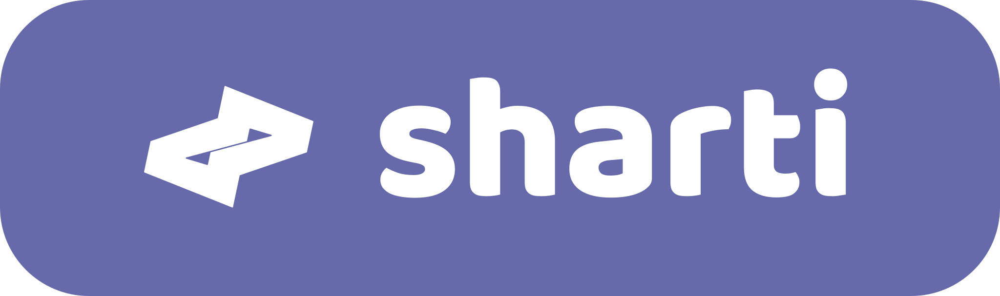

<div align="center">
  <picture>
    
  </picture>

  <p>
    <a href="https://github.com/xpae-tech/sharti/releases">
      
    </a>
    <a href="https://github.com/xpae-tech/sharti/blob/main/LICENSE">
      
    </a>
    
  </p>
</div>

<br>

# Sharti

Sharti is a private, local-first client for working with AI models — and for getting practical work done with them. It can run models on your own Mac through the Splash inference engine, or connect to any OpenAI-compatible API. Chats, settings and API keys never leave your computer.

Beyond that, Sharti is a working environment for agentic tasks. With the built-in **sharti-agent** toolkit, a model can inspect files, edit code, manage folders and run commands on your machine — with your approval at each step, or automatically when you prefer.

## Architecture at a glance

- **Small local service** — a TypeScript backend built on Hono serves the API, streams responses over SSE and manages the Splash engine as a subprocess.
- **Lightweight interface** — the frontend is vanilla TypeScript built with Vite, with no UI framework in the way.
- **One set of contracts** — shared types keep the backend and frontend in sync.
- **Flat-file storage** — conversations, folders, preferences and MCP configuration are JSON files under `./data`. There is no database to install.
- **Local by design** — the server binds to loopback, browser origins are allowlisted, and API keys stay on disk. The browser only learns whether a key is set, never the key itself.

## Features

### Chats and organization

- Start new conversations, rename them, delete them, and reveal their files in Finder.
- Search across all chats instantly from the sidebar.
- Create folders, rename or delete them, and move conversations between folders with drag and drop.
- Import images and PDFs as attachments; images can be opened in a full-size preview.

### Models and connections

- Run local models through the Splash engine: browse installed models, start and stop them, and see readiness, context size and memory use.
- Download models with live progress, speed and ETA, and cancel a download at any time.
- Choose a recommended model for your machine's RAM.
- Configure launch options such as memory limits, SSD cache, network access and API behaviour.
- Connect any OpenAI-compatible provider (local or remote), save multiple connections, and switch between the local engine and external APIs.
- Use mixed mode to move between the local engine and an external provider automatically.
- Get model and capability discovery, so the UI knows about vision, reasoning and context limits.

### Tuning and generation

- Edit the system prompt and sampling parameters per model.
- Pick a reasoning effort when the model supports it.
- Watch token usage and generation speed while the model writes.
- Stop a response at any time and retry the last turn.

### Agentic tools, plugins and MCP

- Enable the built-in `sharti-agent` plugin and let a model work directly with your machine: read, write and patch files, create, move, rename and delete files and folders, inspect the environment, and run shell commands.
- Put it to work on everyday tasks — updating a config, renaming a batch of files, running a test suite, or working through a small refactor — without leaving the conversation.
- Approve tool calls before they run, or let them proceed automatically; individual native tools can be disabled.
- Add MCP servers through `mcp.json`, reload them after editing, and see each server's status and available tools.
- Review tool activity directly in the conversation.

### Interface and privacy

- Light and dark themes that persist between sessions.
- Markdown rendering with syntax-highlighted code blocks.
- Optional LLM request logging for diagnostics, with authentication headers redacted.
- No account, no tracking, no data leaving your machine unless you connect an external provider.

## Requirements

- Node.js 22 or newer
- Optional: Splash runtime **1.5.0** (needed only for managing local models)

## Installation

```bash
npm install
cp .env.example .env
```

## Running

### Development

```bash
npm run dev
```

This starts both:
- the **Vite dev server** on port 5173, with hot reload for the frontend
- the **Sharti backend** on port 3000, serving the API and SSE stream

The browser opens automatically.

### Separate processes

```bash
npm run dev:vite      # frontend only (hot reload)
npm run dev:server    # backend only (tsx watch)
```

### Production build

```bash
npm run build         # backend → dist/index.js, frontend → dist/frontend/
npm start             # run the built service (serves dist/frontend)
```

## Hotkeys

| Key | Action |
|-----|--------|
| ⌘N | New chat |
| ⌘, / ⌘1 | Settings |
| ⌘. | Stop generation |
| Enter | Send message |
| Shift+Enter | New line |
| Escape | Close popup / cancel |

## Author

Made by Aleksandr Xpae

## License

Sharti is released under the [MIT License](LICENSE).

You are free to use, copy, modify, merge, publish, distribute, sublicense and sell copies of the software, provided that the copyright notice and this permission notice are included in all copies or substantial portions of the software. The software is provided "as is", without warranty of any kind.

